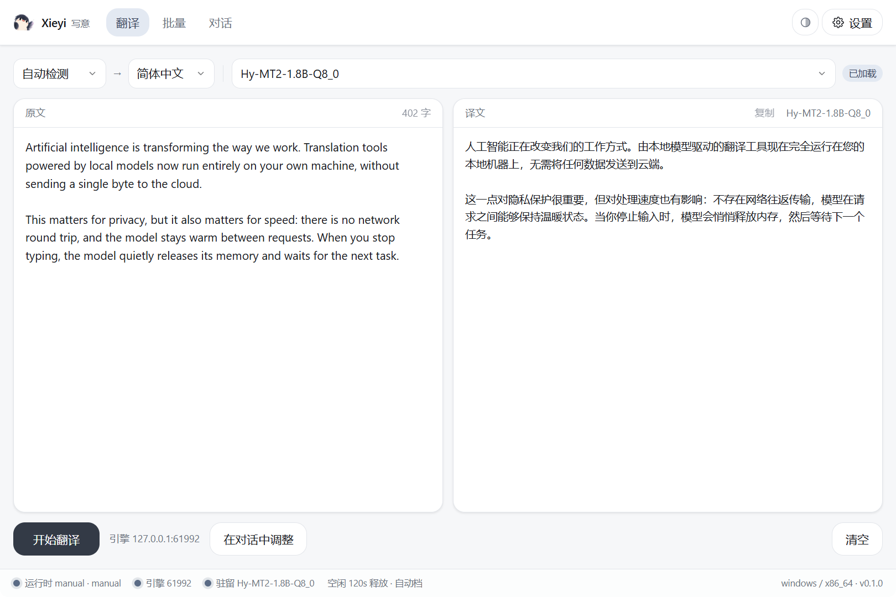

<div align="center">


# Xieyi 写意

</div>

---

<p align="center"><i>本地 GGUF 翻译工具 —— 按需装填模型，停手即还显存。</i></p>

<p align="center">
  
  
  
  
  
  
  
</p>

<p align="center">
  
  
  
</p>

<p align="center">
  <b>本项目是完全离线的本地翻译工具，不依赖任何云端 API。</b><br />
  名字取自「写意」—— 不拘泥字面形似，重神韵：译文不是翻完就结束，可以像改稿一样继续打磨。
</p>

<p align="center">
  基于 <b>Tauri v2 + React 19 + Rust</b>，用 llama.cpp 的<b>路由模式</b>托管本地 GGUF，<br />
  只做「翻译 / 批量翻译 / 译后润色」三件事。
</p>

<p align="center">
  <a href="#快速开始">快速开始</a> ·
  <a href="#核心设计">核心设计</a> ·
  <a href="#三个页面">三个页面</a> ·
  <a href="#模型兼容">模型兼容</a> ·
  <a href="#架构">架构</a> ·
  <a href="#开发与测试">开发与测试</a> ·
  <a href="#许可">许可</a>
</p>

<p align="center"><sub><b>简体中文</b> | <a href="README_EN.md">English</a></sub></p>

---

> [!IMPORTANT]
> **不联网、不常驻、不抢资源。**
> 常驻的只是 llama-server 的**空壳路由进程**（0 显存），模型作为子进程在首次请求时拉起、空闲 120 秒后自动卸载并归还显存。
> 除首次下载推理运行时外，应用不做任何网络请求；随机本地端口 + 本地 api-key，不读取系统里的 `OLLAMA_*` / `LLAMA_*` 环境变量。

---

## 快速开始

**环境要求**：Windows 10 / 11 + WebView2 Runtime、Node.js、Rust stable + MSVC 工具链。

```bash
npm install
npm run tauri dev      # 开发：自动起 Vite + Tauri 窗口
```

启动后跟着**全屏引导层**走两步即可：

1. **装引擎** —— 自动扫描磁盘上现成的 `llama-server`，也可以「指定其他引擎」，或直接下载 **Vulkan 版**（含 SHA-256 校验与 `--version` 自检）
   选 Vulkan 是因为它一套包通吃 NVIDIA / AMD / Intel 和纯 CPU，不必让用户先判断自己是什么显卡；翻译模型体量不大，Vulkan 的性能已经够用
2. **放模型** —— 把 `.gguf` 丢进**程序目录下的 `models`**（不可写时回退 `Documents\Xieyi\models`），或指向已有目录；也可以直接把 `.gguf` 拖进窗口

配置完成后引导层整体消失，三个页面回到本来的样子。也可以「稍后配置」先进去看看。

**打包**：

```bash
npm run tauri build    # NSIS / MSI 安装包，运行时另按需下载
```

## 核心设计

| 取舍 | 做法 |
| :--- | :--- |
| **轻** | 安装包只含 Tauri 外壳；llama.cpp 运行时首次按需下载；模型权重由用户自备，不内置 |
| **不常驻占硬件** | 路由进程 `--models-max 1` + `--no-models-autoload`，永不为空壳加载权重；TTL 默认 120s，可把某个模型标为「常驻」 |
| **本地与隐私** | 随机端口 + 本地 api-key；不读系统模型环境变量；译文、会话、配置全部落在本机 |
| **快** | 流式输出、翻译结果内存缓存、固定 prompt 前缀命中 slot 缓存、预热把 Vulkan 着色器编译挪到加载阶段 |
| **克制的边界** | 不做工具调用、不做自主循环、不做 Markdown 渲染、不做多模型同时驻留 |

**它不是**：云端翻译服务、通用聊天客户端、模型管理器、多模型并发服务。
对话页的定位是「翻译的二次加工台」—— 把译文带过去，改语意、调语气、统一术语。

## 三个页面

| 页面 | 作用 | 关键能力 |
| :--- | :--- | :--- |
| **翻译** | 粘贴文本 → 流式译文 | 14 种语言（简繁分列）、术语表、长文分段、质检自检与自动修正、一键发送到对话页 |
| **批量** | 拖入 txt / md / srt → 生成 `*.目标语言.*` | 文件级并发 2、SRT 结构保留、GB18030 解码、片段失败重试、不覆盖已有输出、质检统计 |
| **对话** | 译文的二次加工 | 多轮、思维链实时显示与回看、消息版本分支、编辑重发 / 单条删除 / 重新生成、会话本地落盘、上下文用量环、快捷指令 |

<p align="center">
  
  <br />
  <sub>翻译 —— 左原文右译文，流式输出，底部显示引擎端口与驻留状态</sub>
</p>

<p align="center">
  
  <br />
  <sub>批量 —— 拖入文件即排队，输出写到原文件旁边，汇总成功与耗时</sub>
</p>

<p align="center">
  
  <br />
  <sub>对话 —— 译文的二次加工台，快捷指令与上下文用量环</sub>
</p>

## 模型兼容

不同翻译模型的调用方式差异极大。工具会读 GGUF 的 `chat_template` 特征 **+ 文件名**自动判断该用哪种机制，**不维护型号名单**（新模型月月出，名单必然滞后）：

| 模型家族 | 调用机制 | 说明 |
| :--- | :--- | :--- |
| 通用对话模型（Qwen / Llama / Gemma…） | `EnglishSystem` | 英文 system prompt，兜底路径 |
| Index-Translate | `ChineseText` | 中文文本提示 + 硬性约束块 |
| TranslateGemma | `TemplateKwargs` / `Delimiter` | 语言码走 `chat_template_kwargs`；繁体必须用 `zh-TW` |
| NVIDIA Riva-Translate | `LanguagePair` | system 直接传 `zh-en` 这类语言对 |
| **Hy-MT2 / 腾讯混元** | `ChineseOfficial` | 腾讯官方中文模板，**不能收英文 system** |
| Seed-X | — | 官方无 chat 模板，标记为不可用 |

> 识别不准时，可在设置里手动勾选某个模型「能不能用在对话页」—— 认不出的模型一律按通用对话模型处理，绝不让它从界面消失。

**翻译专用模型要按它的训练格式喂。** 这条经验是踩出来的：Hy-MT2-1.8B 收到英文 system prompt 时短词会原样返回、要繁体却永远给简体；换成官方中文模板后全部正常。遇到行为古怪的翻译模型，先查它的官方模型卡。

## 架构

```
┌──────────────── WebView2（React 19）────────────────┐
│  App.tsx：三页常驻挂载 + 顶部页签 + 设置抽屉          │
│  lib/ipc.ts：所有 invoke 命令与事件监听集中于此        │
└──────────────────────▲───────────────────────────────┘
                       │ Tauri IPC（命令 + 事件）
┌──────────────────────┴───────────────────────────────┐
│  Rust 后端                                            │
│  service.rs：引擎与模型生命周期、流式补全、翻译流水线   │
│  batch / translate / quality / prompts / runtime /    │
│  models / params / sessions / paths / hardware        │
└──────────────────────▲───────────────────────────────┘
                       │ HTTP 127.0.0.1:<随机端口>，Bearer <本地随机 key>
┌──────────────────────┴───────────────────────────────┐
│  llama-server（路由模式，常驻空壳，0 显存）            │
│    └─ 模型子进程：首次请求时 load，TTL 到期后 unload   │
└──────────────────────────────────────────────────────┘
```

三条全局约束：

1. **单推理通道** —— 翻译、批量、对话共用一把推理锁，同一时刻只有一个请求在跑（避免打爆 llama.cpp 共享的 KV 池）
2. **单模型驻留** —— 换模型就卸载再加载
3. **一切状态可中断** —— 全局取消位，加载 / 翻译 / 批量 / 对话都在检查点退出并清理子进程

## 数据与文件

全部集中在 `%LOCALAPPDATA%\com.xieyi.translate`，与 WebView2 缓存同根，`Roaming` 下不生成任何东西。

| 内容 | 路径 |
| :--- | :--- |
| 用户配置（含引擎信息） | `<数据根目录>\config.json` |
| 会话历史 | `<数据根目录>\sessions\<id>.json` |
| 下载 / 指定的推理引擎 | `<数据根目录>\runtime\llama-<版本>-<backend>\` |
| 默认模型目录 | **程序目录下的 `models`**（不可写时回退 `Documents\Xieyi\models`） |

> **删掉数据根目录 = 还原出厂设置**，模型目录在别处不受影响。

## 开发与测试

```bash
npm test                    # 前端：Vitest + Testing Library
cd src-tauri && cargo test  # 后端：Rust 单测
```

> `cargo test` **必须在 `src-tauri/` 目录执行**，在仓库根目录会失败。
> 前端测试用 `vi.mock("lib/ipc")` 全量打桩，不启动 Tauri / 引擎，数秒跑完。

改完代码的验证顺序：`npx tsc --noEmit` → `npm test` → `cargo test` →（必要时）`npm run tauri build`。

详细的项目交接、机制说明与历史决策见 `docs/`（本地文档，不入库）。

## 已知限制

- **推理运行时跟随固定的 llama.cpp 版本**：路由模式属于较新特性，不跟 latest，避免行为漂移；升级时需重新做全链路实测
- **显存自动估算仅 NVIDIA**：通过 `nvidia-smi` 拿空闲显存；AMD / Intel 退化为「全 GPU 层」
- **模型识别依赖文件名**：把 `Hy-MT2-7B.gguf` 改名成 `mymodel.gguf` 会被当通用模型（有意取舍 —— 比靠不可靠的元数据乱猜安全）
- **批量并发上限 2**：实测 4 路会报 `Context size has been exceeded`，文件内不再并发
- **翻译缓存仅内存**：重启即失效，上限 4000 条
- `Hello world` 这类极短文本在 1.8B 模型上仍可能原样返回 —— 质检能检出并提示，属模型能力上限，7B 及以上正常

## 路线图

- [ ] 翻译页显示当前生效的调用机制（识别错了能一眼看出）
- [ ] `Delimiter` / `LanguagePair` 两种机制拿到真实模型实测
- [ ] 引擎切换的端到端验证
- [ ] 对外分发打包：单实例、日志落盘、Job Object 进程回收、自动更新
- [ ] 划词 / 全局快捷键 / 悬浮窗

## 致谢

设计思路参考了这些优秀的开源项目（**只看设计与用法，不复制代码**）：

| 项目 | 许可 | 借鉴点 |
| :--- | :--- | :--- |
| [llama-swap](https://github.com/mostlygeek/llama-swap) | MIT | 进程树清理、加载进度、TTL 与路由配置 |
| [STranslate](https://github.com/STranslate/STranslate) | MIT | 翻译源接口、多套提示词、回译思路 |
| [jan](https://github.com/janhq/jan) | Apache-2.0 | Tauri v2 工程组织、消息状态模型 |
| [LinguaGacha](https://github.com/neavo/LinguaGacha) | 未声明 | 批量任务状态机、质量规则（仅参考思路） |
| [pot-desktop](https://github.com/pot-app/pot-desktop) | GPL-3.0 | 快捷键与托盘的设计思路（**未复制任何代码**） |

## 许可

本项目基于 [MIT License](LICENSE) 开源。

---

<p align="center">
  <sub>Xieyi 写意 · 本地优先，安静准确</sub><br />
  <sub><a href="README_EN.md">Read in English</a></sub>
</p>
