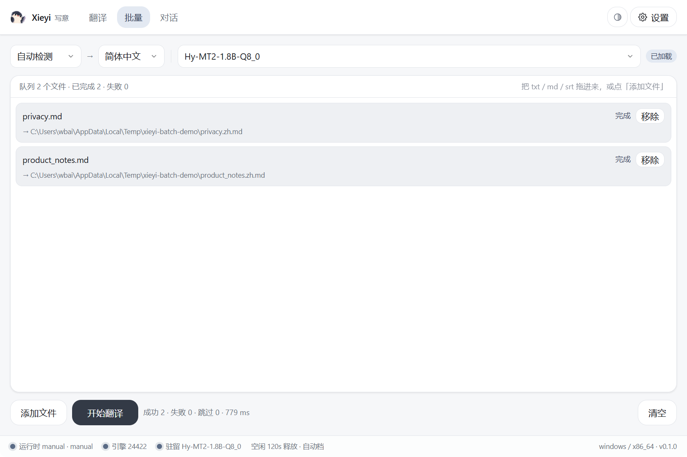
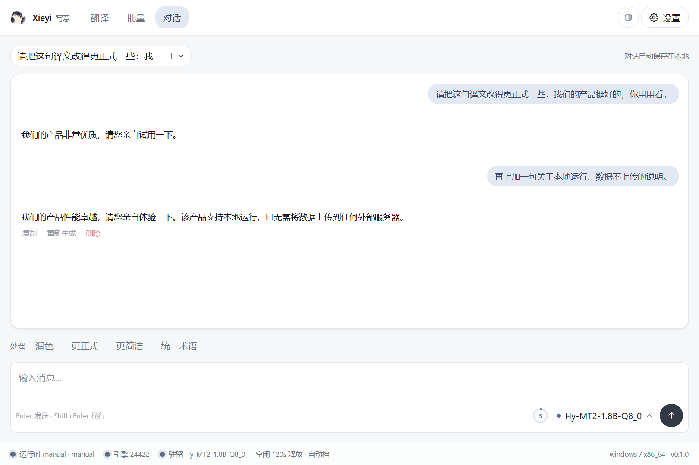

<div align="center">


# Xieyi 写意

</div>

---

<p align="center"><i>本地 GGUF 翻译工具 —— 按需装填模型，停手即还显存。</i></p>

<p align="center">
  
  
  
  
  
  
  
</p>

<p align="center">
  
  
  
</p>

<p align="center">
  <b>完全离线的本地翻译工具，不依赖任何云端 API。</b><br />
  名字取自「写意」—— 不拘泥字面形似，重神韵：译文不是翻完就结束，可以像改稿一样继续打磨。
</p>

<p align="center">
  <a href="#下载安装">下载安装</a> ·
  <a href="#第一次启动">第一次启动</a> ·
  <a href="#三个页面">三个页面</a> ·
  <a href="#模型怎么选">模型怎么选</a> ·
  <a href="#文件都在哪">文件都在哪</a> ·
  <a href="#常见问题">常见问题</a> ·
  <a href="#参与开发">参与开发</a>
</p>

<p align="center"><sub><b>简体中文</b> | <a href="README_EN.md">English</a></sub></p>

---

> [!IMPORTANT]
> **不联网、不常驻、不抢资源。**
> 常驻的只是推理引擎的**空壳路由进程**（0 显存）。模型在首次请求时拉起，
> 空闲 300 秒（5 分钟）后自动卸载并归还显存。
> 除首次下载推理运行时外，应用不做任何网络请求。

---

## 它是什么

一句话：**把 `.gguf` 模型变成一个好用的翻译工具。**

你不用碰命令行、不用配 OpenAI 兼容接口、不用担心文档被上传。
装好外壳、放一个模型文件进去，就能翻译。

**它只做三件事**：

| 页面 | 干什么 |
| :--- | :--- |
| **翻译** | 粘贴一段文本，出译文。带质检，可疑的片段会被标出来并自动重试 |
| **批量** | 拖入一堆 `txt` / `md` / `srt`，批量翻译，结果写在原文件旁边 |
| **对话** | 译文的二次加工台：改语意、调语气、统一术语 |

**它不是**：云端翻译服务、通用聊天客户端、模型管理器、多模型并发服务。

---

## 下载安装

| 平台 | 状态 | 获取方式 |
| :--- | :--- | :--- |
| **Windows 10 / 11** | ✅ 实测通过 | [Releases](https://github.com/yunyiss/Xieyi/releases) 下载 `Xieyi_x.y.z_x64-setup.exe` |
| **Linux (x64)** | ✅ 实测通过（X11；Wayland 下窗口聚焦不可用） | `Xieyi_x.y.z_amd64.deb` 或 `.rpm` |
| **macOS (Apple Silicon)** | ⚠️ **源码可编译，运行行为未验证** | 不提供预编译包，请从源码构建 |

> **关于 macOS**：代码里有完整的 macOS 分支（单实例、`NSRunningApplication`
> 聚焦、`ps` 兜底清理、Metal 推理后端），CI 也会在真机上编译一次。
> 但**没有任何人在 Mac 上实际跑过完整流程**，所以不发布安装包、也不声称支持。
> 如果你愿意试并反馈，非常欢迎。

**安装包只有 3 MB 左右**，因为不含推理引擎和模型——两者都在首次启动时按需获取。
推理引擎下载约 30 MB，带 SHA-256 校验。

---

## 第一次启动

启动后会出现一个**全屏引导层**，走两步就能用。也可以点「稍后配置」先进界面看看。

### 第 1 步：装引擎

程序会自动扫描磁盘上现成的 `llama-server`（如果你装过 Ollama、LM Studio 之类），
也可以「指定其他引擎」的路径，或者直接点下载。

> **推荐直接下载**。默认选 **Vulkan 版**，因为它一套包通吃 NVIDIA / AMD / Intel
> 和纯 CPU，不需要你先判断自己是什么显卡。翻译模型体量不大，Vulkan 的性能完全够用。

下载完成后会做 SHA-256 校验并跑一次 `--version` 自检，确认引擎真能起来。

### 第 2 步：放模型

把 `.gguf` 文件放进**程序目录下的 `models` 文件夹**，
或者用界面指向你已有的模型目录，也可以直接把 `.gguf` 拖进窗口。

> 程序目录不可写时（比如装在 `Program Files`），会自动回退到
> `Documents\Xieyi\models`。

配置完成后引导层整体消失。

---

## 三个页面

### 翻译

粘贴文本 → 流式译文。

- **14 种语言**，简体与繁体分列
- **术语表**：指定某些词怎么译，全篇统一
- **长文分段**：超长文本自动切分，逐段翻译
- **质检**：译完自检，可疑片段自动重试修正，底部显示 `质检 2/12 段 · 均已修正`
- **一键发送到对话页**：译完想再打磨，直接带过去

<p align="center">
  
  <br />
  <sub>左原文右译文，流式输出，底部显示引擎端口与驻留状态</sub>
</p>

### 批量

拖入文件即排队。

- 支持 `txt` / `md` / `srt`，**SRT 的时间轴与结构完整保留**
- 自动识别 `GB18030` 编码（中文老文件常见）
- 输出文件名为 `原名.目标语言.txt`，**不覆盖已有文件**
- 单个片段失败会重试，不因一处失败中断整个文件
- 结束后给出成功数与耗时汇总

> **并发上限是 2**。这不是保守，是实测：4 路并发会打爆 llama.cpp 共享的
> KV 池，报 `Context size has been exceeded`。

<p align="center">
  
  <br />
  <sub>拖入文件即排队，输出写到原文件旁边，汇总成功与耗时</sub>
</p>

### 对话

译文的**二次加工台**。把译文带过来，继续改。

- 多轮对话，**思维链实时显示**也可回看
- **消息版本分支**：重新生成保留旧版，可以来回切换对比
- 编辑重发 / 单条删除
- 会话本地落盘，重启还在
- 上下文用量环，快满了会提示压缩
- 快捷指令：一键把「更书面」「更口语」这类固定要求并进消息

<p align="center">
  
  <br />
  <sub>译文的二次加工台，快捷指令与上下文用量环</sub>
</p>

---

## 模型怎么选

**都能用。** 放进去就能识别，认不出的按通用对话模型处理——绝不会让某个模型从界面上消失。

不同翻译模型的「喂法」差异极大：有的要英文 system prompt，有的只认中文模板，
有的语言码得走特殊参数。工具会读 GGUF 的 `chat_template` 特征**加上文件名**
自动判断，**不维护型号名单**（新模型月月出，名单必然滞后）。

| 模型家族 | 调用机制 | 备注 |
| :--- | :--- | :--- |
| 通用对话模型（Qwen / Llama / Gemma…） | 英文 system prompt | 兜底路径，任何模型都能走 |
| Index-Translate | 中文文本提示 | 带硬性约束块 |
| TranslateGemma | 模板参数 / 分隔符 | 繁体必须用 `zh-TW` |
| NVIDIA Riva-Translate | 语言对直传 | system 里直接给 `zh-en` |
| **Hy-MT2 / 腾讯混元** | 腾讯官方中文模板 | **不能收英文 system** |
| Seed-X | — | 官方无 chat 模板，标为不可用 |

> **翻译专用模型一定要按它的训练格式喂。** 这条是踩出来的：
> Hy-MT2-1.8B 收到英文 system prompt 时，短词会原样返回、要繁体却永远给简体；
> 换成官方中文模板后全部正常。遇到行为古怪的翻译模型，先查它的官方模型卡。

**模型大小建议**：1.8B 起步能跑，7B 以上明显更稳。
`Hello world` 这种极短文本在 1.8B 上仍可能原样返回——质检能检出并提示，
这属于模型能力上限，不是程序的 bug。

### 认错了？在设置里打个勾就行

识别靠文件名 + `chat_template` 特征，**不维护型号名单**。这带来一个必然的代价：
你把 `Hy-MT2-7B.gguf` 改名成 `mymodel.gguf`，或者用一个从没见过的冷门模型，
它就会被当成**通用对话模型**——能翻，但没走最优的调用方式。

不用改文件名，也不用去查文档。打开「设置 → 模型与术语」，每个模型那行都有两个勾：

| 勾选 | 作用 |
| :--- | :--- |
| **对话** | 勾上 = 允许它出现在对话页；取消 = 只在翻译/批量页出现 |
| **常驻** | 勾上 = 空闲时也不卸载，一直占着显存 |

改过的会显示「·手动」，说明这个选择以你为准，不再跟着自动识别走。
**想恢复自动判定**：把那个勾调回到「自动识别的那个值」即可——比如自动判定
它本来就能对话，你取消后又勾回来，覆盖记录会自动清掉，重新跟随识别。

> **为什么要留这个口子**：自动识别一定会有认错的时候（改名、冷门模型、新的
> 量化变体）。让用户只能干瞪眼，或者逼他去动模型文件名，都是不合理的。
>
> **默认方向是「宁可多认，不可漏掉」**：认不出的模型一律当通用对话模型处理，
> 绝不会让它从界面上消失。最坏情况只是提示词不是最优，而不是"模型不见了"。

---

## 文件都在哪

全部集中在一个数据目录，与 WebView2 缓存同根，不往 `Roaming` 里写东西。

| 平台 | 数据根目录 |
| :--- | :--- |
| Windows | `%LOCALAPPDATA%\com.xieyi.translate` |
| Linux | `~/.local/share/com.xieyi.translate` |
| macOS | `~/Library/Application Support/com.xieyi.translate` |

里面有：

| 内容 | 位置 |
| :--- | :--- |
| 用户配置（含引擎信息） | `<数据根目录>/config.json` |
| 会话历史 | `<数据根目录>/sessions/<id>.json` |
| 日志（保留 7 天） | `<数据根目录>/logs/xieyi-YYYY-MM-DD.log` |
| 下载的推理引擎 | `<数据根目录>/runtime/llama-<版本>-<backend>/` |

> **删掉数据根目录 = 还原出厂设置。** 模型目录在别处，不受影响。

### 卸载会留下什么

- **安装版**（Windows 默认装到 `%LOCALAPPDATA%\Xieyi`，不需要管理员权限）：
  卸载界面有一个 **「Delete the application data」** 勾选项，默认**不勾**。
  - 不勾：只删程序文件、快捷方式和注册表项，数据根目录与 `models/` 都保留，
    重装后可以接着用。
  - 勾上：连数据根目录一起删除（配置、会话、已下载的推理引擎）。
  - 两种情况都**不会**删 `models/` 里的 `.gguf`：模型动辄数 GB，误删重下
    代价太高，需要清空请手动删除该目录。
  - 静默卸载（`/S`）不弹界面，按「不勾」处理，保留数据。
- **便携版**：没有安装/卸载这一步，数据与模型都在程序旁的 `data/`、`models/`，
  删掉整个文件夹即彻底清除，系统目录不留任何东西。

---

## 常见问题

**Q：双击图标没反应 / 提示「资源在使用中」？**
上一次异常退出留下了 WebView 缓存锁。等几秒再试；或者在任务管理器里
结束所有 `msedgewebview2.exe`；再不行重启一次。

**Q：翻译很慢？**
先确认走的是 GPU。设置里能看到引擎后端和驻留状态。
纯 CPU 能跑但慢很多，1.8B 模型在 CPU 上大约每秒几十个 token。

**Q：第一次翻译要等几秒？**
模型首次使用要从磁盘加载权重并预热。想省掉这段等待，可以在
设置 → 引擎里打开「启动时预加载模型」：启动会多花几秒、并立刻占用显存，
之后的第一次翻译几乎不用等。默认关闭。

**Q：显存被吃满 / 想让它早点释放？**
默认空闲 300 秒（5 分钟）卸载。可以在设置里调整 TTL，或者手动点卸载。

**Q：关了程序，但显存没释放？**
不该发生——Windows 用 Job Object、Linux 用 `PR_SET_PDEATHSIG`，
主进程死亡时内核会终止整棵进程树。如果真遇到了，把日志发出来
（`<数据根目录>/logs/`），那是需要修的 bug。

**Q：能同时开两个窗口吗？**
不能，单实例。再点图标会把已有窗口拉到前面。

**Q：支持 AMD / Intel 显卡吗？**
支持，走 Vulkan。显存估算直接问推理引擎（`llama-server --list-devices`），
CUDA / Vulkan / ROCm / Metal 都能报出可用显存，所以自动层数对各家显卡都有效。
拿不到时（老版本引擎、手动指定的非 llama.cpp 程序）会退回读 `nvidia-smi`，
再拿不到才退化成「全部层都上 GPU」。

**Q：为什么不做 Markdown 渲染？**
对话页是**二次加工台**，不是通用 Agent。完整渲染 HTML/Markdown 会带来
安全和性能上的复杂度，与「轻、快」的定位冲突。

---

## 已知限制

- **推理运行时锁定版本**：跟随固定的 llama.cpp 构建号，不跟 `latest`，避免行为漂移
- **模型识别依赖文件名**：把 `Hy-MT2-7B.gguf` 改名成 `mymodel.gguf` 会被当通用模型
- **批量并发上限 2**：实测 4 路会报 `Context size has been exceeded`
- **显存估算可能偏保守**：引擎与 `nvidia-smi` 都拿到数时取较小值，宁可少放几层（慢一点）也不冒加载失败的风险
- **Wayland 下窗口聚焦不可用**：协议层面禁止应用操作其他窗口，不是能力缺失

---

## 参与开发

见 **[CONTRIBUTING.md](CONTRIBUTING.md)** —— 架构、构建、测试、验证闸门、平台矩阵。

一句话版本：

```bash
npm install
npm run tauri dev
```

> ⚠️ 构建时**必须用 `npx tauri build`**，不能用 `cargo build --release`。
> 后者不会把前端打包进去，程序会去连不存在的开发服务器然后白屏。
> 详细原因见 CONTRIBUTING。

---

## 致谢

设计思路参考了这些优秀的开源项目（**只看设计与用法，不复制代码**）：

| 项目 | 许可 | 借鉴点 |
| :--- | :--- | :--- |
| [llama-swap](https://github.com/mostlygeek/llama-swap) | MIT | 进程树清理、加载进度、TTL 与路由配置 |
| [STranslate](https://github.com/STranslate/STranslate) | MIT | 翻译源接口、多套提示词、回译思路 |
| [jan](https://github.com/janhq/jan) | Apache-2.0 | Tauri v2 工程组织、消息状态模型 |
| [LinguaGacha](https://github.com/neavo/LinguaGacha) | 未声明 | 批量任务状态机、质量规则（仅参考思路） |
| [pot-desktop](https://github.com/pot-app/pot-desktop) | GPL-3.0 | 快捷键与托盘的设计思路（**未复制任何代码**） |

推理核心是 [llama.cpp](https://github.com/ggml-org/llama.cpp)（MIT）。

---

## 许可

本项目基于 [MIT License](LICENSE) 开源。

---

<p align="center">
  <sub>Xieyi 写意 · 本地优先，安静准确</sub><br />
  <sub><a href="README_EN.md">Read in English</a> · <a href="CONTRIBUTING.md">参与开发</a></sub>
</p>
