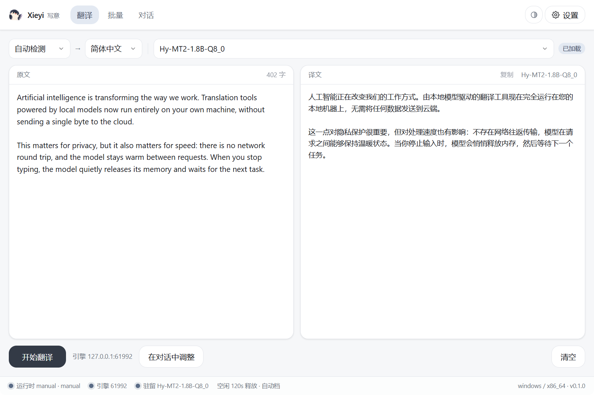
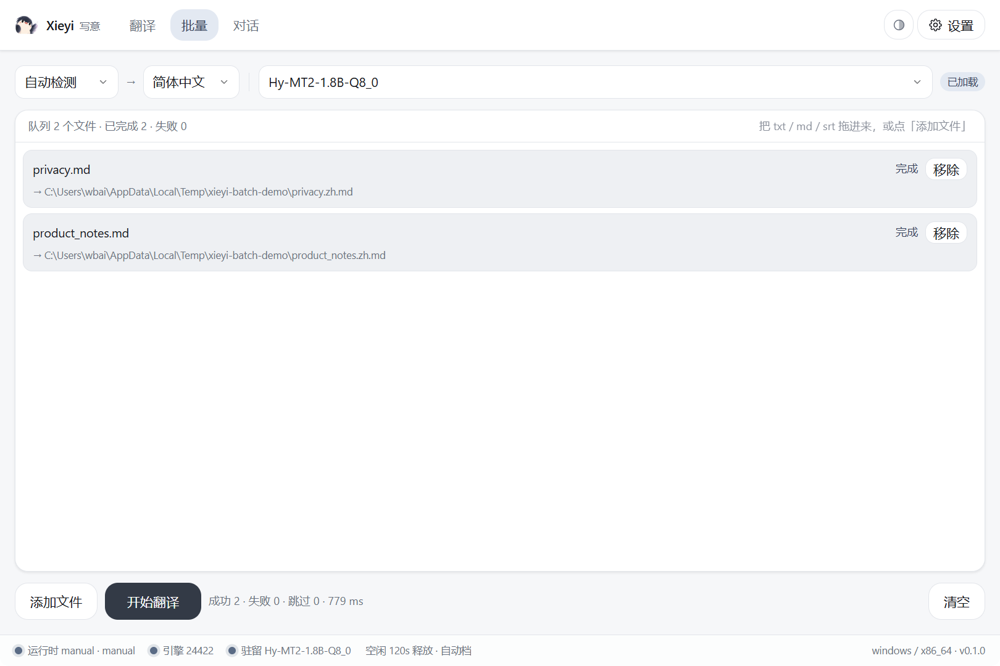
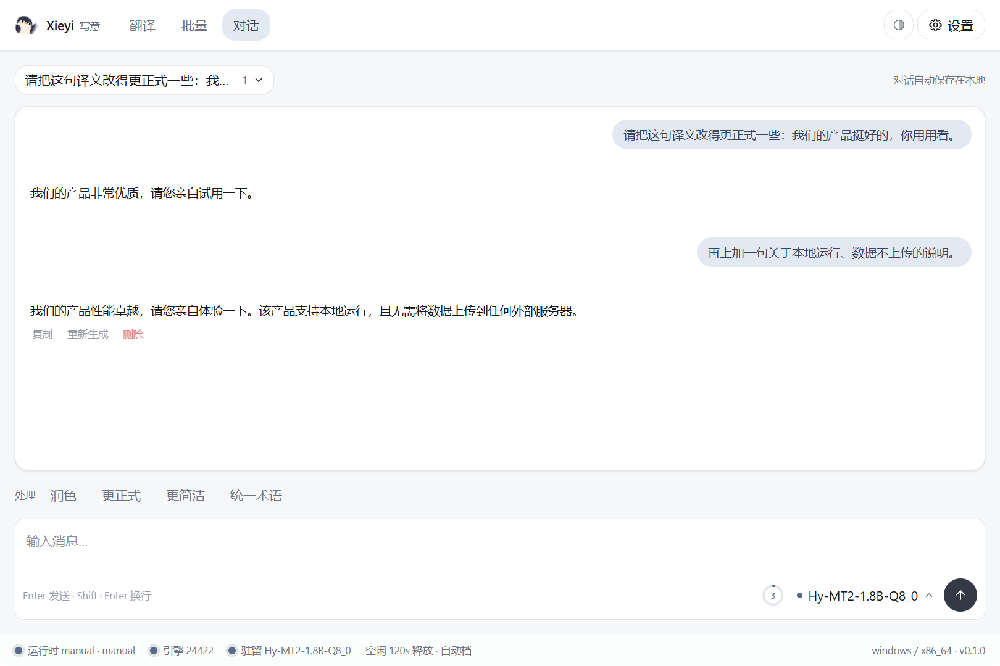

<div align="center">


# Xieyi 写意

</div>

---

<p align="center"><i>A local GGUF translation tool — models load on demand, VRAM returns when you stop.</i></p>

<p align="center">
  
  
  
  
  
  
  
</p>

<p align="center">
  
  
  
</p>

<p align="center">
  <b>Fully offline. No cloud API, no telemetry.</b><br />
  The name comes from <i>xiěyì</i> (写意) — Chinese ink painting that favors the spirit over literal likeness.<br />
  A translation doesn't end when the text is rendered; you can keep refining it like a draft.
</p>

<p align="center">
  Built with <b>Tauri v2 + React 19 + Rust</b>, hosting local GGUF models through llama.cpp's <b>router mode</b>.<br />
  It does exactly three things: <b>translate</b>, <b>batch translate</b>, and <b>post-edit</b>.
</p>

<p align="center">
  <a href="#quick-start">Quick Start</a> ·
  <a href="#design">Design</a> ·
  <a href="#three-pages">Three Pages</a> ·
  <a href="#model-compatibility">Model Compatibility</a> ·
  <a href="#architecture">Architecture</a> ·
  <a href="#development">Development</a> ·
  <a href="#license">License</a>
</p>

<p align="center"><sub><b>English</b> | <a href="README.md">简体中文</a></sub></p>

---

> [!IMPORTANT]
> **No network. No idle footprint. No resource contention.**
> What stays resident is only the llama-server **router shell** (0 VRAM). Each model is a child process spawned on first request and unloaded after 120s of idle, returning its VRAM.
> Except for the one-time runtime download, the app makes no network requests. It binds a random local port with a random local api-key, and ignores `OLLAMA_*` / `LLAMA_*` environment variables.

---

## Quick Start

**Requirements**: Windows 10/11 + WebView2 Runtime, Node.js, Rust stable + MSVC toolchain.

```bash
npm install
npm run tauri dev      # starts Vite + the Tauri window
```

Then follow the full-screen onboarding — only two steps:

1. **Get an engine** — scan the disk for an existing `llama-server`, point to one manually, or download the **Vulkan build** (SHA-256 verified and self-checked via `--version`)
   Vulkan is the default because one build covers NVIDIA, AMD, Intel and CPU-only machines, so users never have to figure out their own GPU first — and translation models are small enough that Vulkan performance is plenty.
2. **Add models** — drop `.gguf` files into the `models` folder **next to the executable** (falls back to `Documents\Xieyi\models` if that's read-only), point to an existing folder, or just drag a `.gguf` onto the window

Once both are set, the overlay disappears and the three pages look exactly as they should. You can also choose "configure later" and look around first.

**Build an installer**:

```bash
npm run tauri build    # NSIS / MSI installers; the runtime downloads on demand
```

## Design

| Trade-off | How it's done |
| :--- | :--- |
| **Light** | The installer ships only the Tauri shell; the llama.cpp runtime downloads on first use; model weights are user-supplied |
| **No idle footprint** | The router runs `--models-max 1 --no-models-autoload`, so the shell never holds weights; TTL defaults to 120s, and any model can be pinned as resident |
| **Local & private** | Random port + local api-key; no model env vars read; translations, sessions and settings never leave the machine |
| **Fast** | Streaming output, in-memory translation cache, a stable prompt prefix that hits the slot cache, and warm-up that moves Vulkan shader compilation into the load phase |
| **Deliberately narrow** | No tool calling, no autonomous loops, no Markdown rendering, no concurrent models |

**It is not**: a cloud translation service, a general chat client, a model manager, or a multi-model server.

The chat page is a *post-editing workbench* for translated text — take a translation there, then adjust meaning, tone, or terminology.

## Three Pages

| Page | Purpose | Highlights |
| :--- | :--- | :--- |
| **Translate** | Paste text → streaming translation | 14 languages (Simplified/Traditional split), glossary, long-text segmentation, quality checks with auto-correction, send to chat |
| **Batch** | Drop txt / md / srt → produces `*.target.*` | File-level concurrency of 2, SRT structure preserved, GB18030 decoding, per-segment retry, never overwrites existing output, quality stats |
| **Chat** | Post-editing the translation | Multi-turn, live reasoning display, message version branches, edit-and-resend / delete / regenerate, sessions saved locally, context usage ring, quick actions |

<p align="center">
  
  <br />
  <sub>Translate — source and target side by side, streaming output, engine status in the footer</sub>
</p>

<p align="center">
  
  <br />
  <sub>Batch — drop files to queue them, output written next to the source, with a success summary</sub>
</p>

<p align="center">
  
  <br />
  <sub>Chat — the post-editing workbench, with quick actions and a context usage ring</sub>
</p>

## Model Compatibility

Translation models are called very differently from one another. Instead of maintaining a model list (new models ship monthly — any list goes stale), the app inspects the GGUF's `chat_template` **plus the filename** and picks the right mechanism:

| Family | Mechanism | Notes |
| :--- | :--- | :--- |
| General chat models (Qwen / Llama / Gemma…) | `EnglishSystem` | English system prompt, the safe fallback |
| Index-Translate | `ChineseText` | Chinese text prompt with hard constraints |
| TranslateGemma | `TemplateKwargs` / `Delimiter` | Language codes via `chat_template_kwargs`; Traditional Chinese must be `zh-TW` |
| NVIDIA Riva-Translate | `LanguagePair` | System prompt carries pairs like `zh-en` |
| **Hy-MT2 / Tencent Hunyuan** | `ChineseOfficial` | Tencent's official Chinese template — **it must not receive an English system prompt** |
| Seed-X | — | No official chat template; marked unavailable |

> If detection gets it wrong, you can override "usable in chat" per model in Settings. Anything unrecognized is treated as a general chat model — it is never removed from the UI.

**Translation models must be fed the format they were trained on.** This one was learned the hard way: given an English system prompt, Hy-MT2-1.8B echoed short words back untranslated and ignored Traditional Chinese entirely; with the official Chinese template everything behaved normally. When a translation model acts strange, check its official model card first.

## Architecture

```
┌──────────────── WebView2 (React 19) ────────────────┐
│  App.tsx: three pages mounted at once + tab bar      │
│  lib/ipc.ts: every invoke command and event listener │
└──────────────────────▲──────────────────────────────┘
                       │ Tauri IPC (commands + events)
┌──────────────────────┴──────────────────────────────┐
│  Rust backend                                       │
│  service.rs: engine/model lifecycle, streaming,     │
│              translation pipeline                   │
│  batch / translate / quality / prompts / runtime /  │
│  models / params / sessions / paths / hardware      │
└──────────────────────▲──────────────────────────────┘
                       │ HTTP 127.0.0.1:<random port>, Bearer <local key>
┌──────────────────────┴──────────────────────────────┐
│  llama-server (router mode, resident shell, 0 VRAM) │
│    └─ model child process: load on first request,   │
│       unload when the TTL expires                   │
└─────────────────────────────────────────────────────┘
```

Three global constraints:

1. **Single inference lane** — translation, batch and chat share one lock, so only one request runs at a time (llama.cpp's KV pool is shared and easy to blow up)
2. **Single resident model** — switching models unloads the previous one
3. **Everything is cancellable** — one global cancel flag; loading, translation, batch and chat all exit at checkpoints and clean up child processes

## Data & Files

Everything lives under `%LOCALAPPDATA%\com.xieyi.translate`, the same root as the WebView2 cache. Nothing is written to `Roaming`.

| Content | Path |
| :--- | :--- |
| Settings (including engine info) | `<data root>\config.json` |
| Chat sessions | `<data root>\sessions\<id>.json` |
| Downloaded / selected runtime | `<data root>\runtime\llama-<version>-<backend>\` |
| Default model folder | `models` **next to the executable** (falls back to `Documents\Xieyi\models`) |

> **Deleting the data root resets the app to factory state.** Model folders stored elsewhere are untouched.

## Development

```bash
npm test                    # frontend: Vitest + Testing Library
cd src-tauri && cargo test  # backend: Rust unit tests
```

> `cargo test` **must run from `src-tauri/`**; running it at the repo root fails.
> Frontend tests stub `lib/ipc` entirely — no Tauri, no engine, done in seconds.

Verification order after a change: `npx tsc --noEmit` → `npm test` → `cargo test` → (if needed) `npm run tauri build`.

Deeper notes on architecture, mechanisms and past decisions live in `docs/` (local-only, not committed).

## Known Limitations

- **The runtime tracks a pinned llama.cpp build** — router mode is a recent feature; tracking `latest` would make behavior drift, so upgrades require re-testing the whole pipeline
- **VRAM auto-estimation is NVIDIA-only** — uses `nvidia-smi`; AMD/Intel fall back to "all layers on GPU"
- **Model detection relies on filenames** — renaming `Hy-MT2-7B.gguf` to `mymodel.gguf` makes it look generic (a deliberate trade-off: safer than guessing from unreliable metadata)
- **Batch concurrency caps at 2** — 4 parallel requests hit `Context size has been exceeded`
- **Translation cache is in-memory only** — cleared on restart, capped at 4000 entries
- Very short inputs like `Hello world` may still come back untranslated on 1.8B models — quality checks catch and report it; it's a model capability limit, fine on 7B and up

## Roadmap

- [ ] Show the active prompt mechanism on the translate page
- [ ] Test `Delimiter` / `LanguagePair` against real models
- [ ] End-to-end verification of engine switching
- [ ] Distribution readiness: single instance, file logging, Job Object process cleanup, auto-update
- [ ] Selection translate / global hotkey / floating window

## Acknowledgments

Design ideas were learned from these projects (**design only — no code copied**):

| Project | License | What we learned |
| :--- | :--- | :--- |
| [llama-swap](https://github.com/mostlygeek/llama-swap) | MIT | Process-tree cleanup, load progress, TTL and router config |
| [STranslate](https://github.com/STranslate/STranslate) | MIT | Translator interfaces, prompt sets, back-translation |
| [jan](https://github.com/janhq/jan) | Apache-2.0 | Tauri v2 project layout, message state model |
| [LinguaGacha](https://github.com/neavo/LinguaGacha) | Unlicensed | Batch state machine, quality rules (ideas only) |
| [pot-desktop](https://github.com/pot-app/pot-desktop) | GPL-3.0 | Hotkey and tray design (ideas only, **nothing copied**) |

## License

Released under the [MIT License](LICENSE).

---

<p align="center">
  <sub>Xieyi 写意 · local-first, quiet and accurate</sub><br />
  <sub><a href="README.md">阅读中文版</a></sub>
</p>
